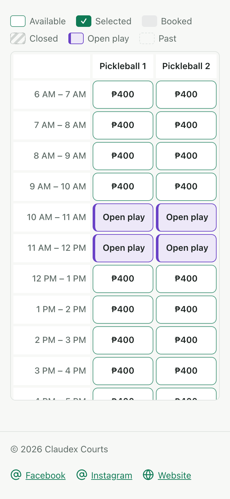
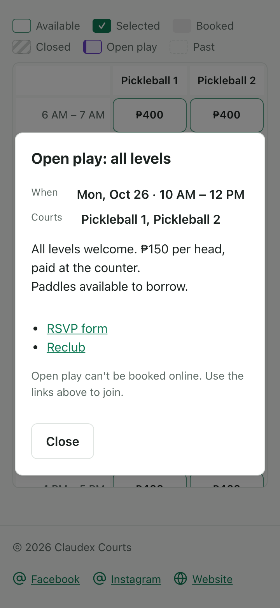
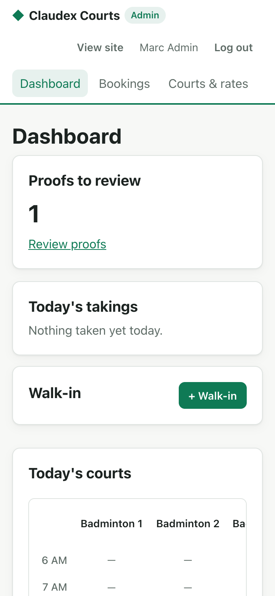

# Claudex Courts

A court booking web app for a single multi-sport venue in the Philippines: badminton, pickleball, basketball and tennis. Players book an hour or more on a court, then pay online through PayMongo (test mode) or pay by GCash, Maya or bank transfer and upload a proof. Staff confirm payments, record walk-ins, run open play sessions and manage the venue from a separate admin area.

**Live demo:** https://court-booking-system-ashen.vercel.app (PayMongo test mode only; no real money moves).

This is a portfolio project. The product spec is [SPEC.md](SPEC.md), the work plan is [TASKS.md](TASKS.md), and the research behind each decision (with sources) is in [RESEARCH.md](RESEARCH.md).

| Booking on a phone | Open play details | Admin dashboard |
| --- | --- | --- |
|  |  |  |

More screenshots, at phone and desktop sizes, are in [docs/screenshots](docs/screenshots). The demo video script is [docs/demo-script.md](docs/demo-script.md).

## What it does

**Players** (guests or signed-in):
- Browse courts with photo galleries, the venue's amenities, location (with a map) and policies.
- Pick consecutive one-hour slots on a live grid. It shows each slot's time range and price, and marks booked, closed, open play and past slots, also for opening hours that run past midnight.
- Check out as a guest (name, email, phone) or with an account. The slot is held while the player pays.
- Pay online with PayMongo (GCash, Maya, card, QR Ph; test mode), confirmed automatically by a signed webhook. Or pay manually and upload a receipt, which staff review.
- Manage the booking from a private link (guests) or from My bookings (accounts). Cancel up to the venue's cutoff.

**Staff** (the `/admin` area, lazy-loaded so players never download it):
- See today's courts with each booker's name, review payment proofs, and record walk-ins.
- Edit courts, rates by day and hour, opening hours (including overnight and 24 hours), blackouts and photos.
- Create one-off open play sessions that block courts and show their details and RSVP links to players.
- Set the venue's location, social links, info sections (waiver, policies, house rules) and amenities.

## Stack

- **Frontend:** Vite, React 19, TypeScript (strict), React Router 7, TanStack Query; lucide-react for the amenity icons. Plain CSS with light and dark themes, mobile-first.
- **Backend:** Supabase. That's Postgres with Row Level Security, Auth (email and Google), Storage, Edge Functions (Deno), and pg_cron with pg_net for background jobs.
- **Payments:** PayMongo Checkout Sessions in test mode, through two Edge Functions.
- **Email:** a transactional outbox drained by an Edge Function. Locally it delivers to Mailpit; email is switched off on the live demo.
- **Hosting:** Vercel for the SPA. One hosted Supabase project.
- **Tests:** Vitest with Testing Library (about 500 tests), pgTAP (about 690 database tests), and Playwright end to end on desktop and a 360px phone, with axe accessibility checks.

## Architecture

```
Browser (React SPA on Vercel)
  ├─ reads:  supabase-js → PostgREST → tables and views, filtered by RLS
  ├─ writes: supabase-js → Postgres RPCs (security definer, every rule checked in SQL)
  └─ files and payments → Edge Functions (submit-payment-proof, create-paymongo-checkout, …)

PayMongo ── signed webhook ──> paymongo-webhook (Edge Function) ──> record_paymongo_payment (RPC)
pg_cron ──> expire_holds() every minute; kicks send-emails when the outbox has work
```

The rules live in the database, not just in the UI:
- **No double booking.** An exclusion constraint on `bookings (court_id, during tstzrange)` makes overlaps impossible.
- **One write path.** Bookings are written only through RPCs (`create_booking`, `create_walk_in`, `cancel_booking`, `review_payment`), and prices are computed on the server.
- **Open play.** Sessions and bookings can't overlap. Because that rule spans two tables, each side checks the other under a per-court advisory lock.
- **RLS on every table**, with admin checks through `private.is_admin()`. Guests reach their booking with a random token that's stored only as a hash and kept in the URL fragment, which browsers never send to servers.
- **Timezone.** Times are `timestamptz` and shown in Asia/Manila. An "operating day" can run past midnight, and a 1 AM slot belongs to the day before.

```
src/
  features/<area>/   booking, admin, auth, account, catalog, openPlay, venue
                     (api.ts: plain async Supabase calls; hooks.ts: React Query hooks; components and tests)
  components/        shared UI (photo viewer, error and loading states, …)
  lib/               the Supabase client, generated database types, time and format helpers
  routes/            the router (admin routes lazy-loaded)
supabase/
  migrations/        every schema change, timestamped SQL
  tests/database/    pgTAP, one file per area
  functions/         Edge Functions (Deno)
e2e/                 Playwright flows against the full local stack
```

## Run it locally

You need Node 22.12 or newer (Vite 8) and Docker Desktop (for the local Supabase stack).

```bash
npm install
npx supabase start                 # local Postgres, Auth, Storage, Edge Functions and Mailpit (migrations and seed applied)
cp .env.example .env               # then set VITE_SUPABASE_URL and VITE_SUPABASE_PUBLISHABLE_KEY
                                   # to the API URL and publishable key printed by `npx supabase status`
cp supabase/functions/.env.example supabase/functions/.env   # PayMongo in stub mode, emails to Mailpit
npm run dev                        # http://localhost:5173
```

Only publishable keys go in the frontend. PayMongo and email secrets are Edge Function secrets. `VITE_GOOGLE_MAPS_EMBED_KEY` is optional: without it, the venue map uses Google's keyless embed. Sign-up emails arrive in Mailpit at http://127.0.0.1:54324. To make yourself an admin, set your profile's `role` to `admin` in Supabase Studio (http://127.0.0.1:54323).

## Tests

```bash
npm run verify      # typecheck, lint, Vitest, pgTAP (local database), production build: the gate for "done"
npm run test:e2e    # Playwright on desktop and 360px against the local stack (needs `npx supabase start`)
npm run screenshots # regenerates docs/screenshots with temporary demo data, then removes it
```

pgTAP tests run in a transaction that's rolled back, acting as anon, a player and an admin through `set local role` and JWT claims. The e2e flows tag their data (`E2E…`, `e2e-…@example.com`) so global teardown removes it.

## Deployment

- Vercel builds `master` as production and other branches as previews.
- **Previews share the production database**: there's one hosted Supabase project (RESEARCH.md, M8). Treat preview testing as production data.
- Schema changes are migrations applied with `npm run db:push`, expand-then-contract, so the live frontend keeps working while the database changes ahead of it.
- PayMongo runs in test mode, and the live demo sends no emails.

## How it was built

Every task in [TASKS.md](TASKS.md) went through the same loop: research (recorded in RESEARCH.md), a plan gate for database or security work, then building with tests. `npm run verify` and the e2e suite had to pass, and a reviewer agent checked the work against the spec before each commit. The decisions log in SPEC.md §10 records why things are the way they are.
